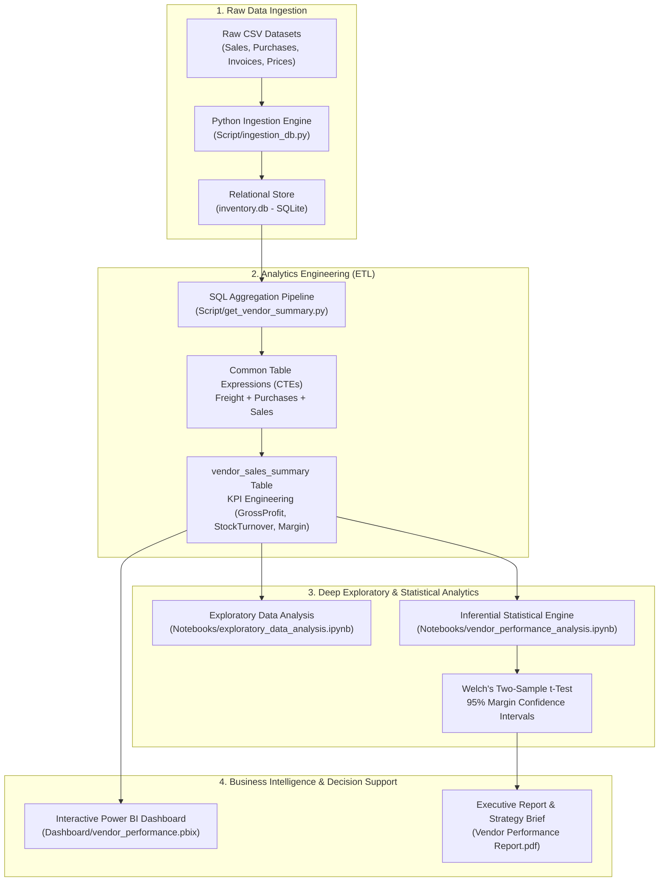
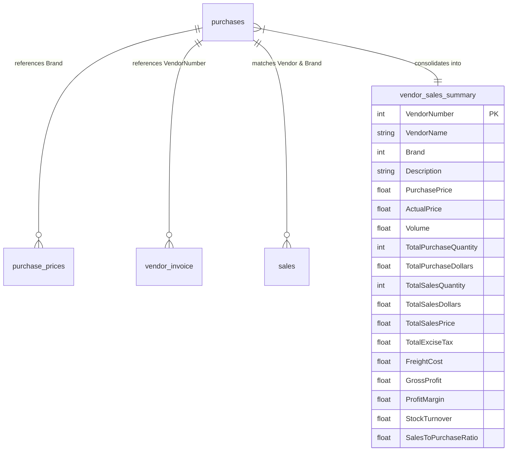
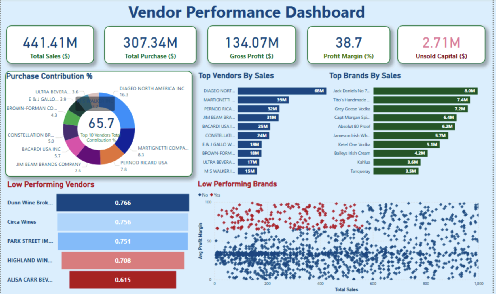

# 📊 Vendor Performance Analysis & Inventory Optimization

[](https://www.python.org/)
[](https://www.sqlite.org/)
[](https://pandas.pydata.org/)
[](https://scipy.org/)
[](https://powerbi.microsoft.com/)
[](https://github.com/avaneetsingh47-hub)

> An end-to-end retail supply chain and vendor performance intelligence pipeline. Integrates multi-source transactional data via SQL ETL, models inventory velocity and procurement concentration, and applies inferential statistical testing (Welch's t-test) to formulate working capital and gross margin optimization strategies.

---

## 📑 Executive Summary

In retail and distribution operations, vendor performance directly governs profitability, working capital allocation, and supply chain continuity. This project delivers a comprehensive analytical framework evaluating vendor reliability, margin contributions, procurement volume discounts, and inventory turnover efficiency across hundreds of brands.

```
                    KEY PERFORMANCE HIGHLIGHTS
┌───────────────────────────┬───────────────────────────┬───────────────────────────┐
│       $2.71M Capital      │        72% Unit Cost      │      65.7% Spend Risk     │
│   Locked in Slow Inventory│    Savings via Bulk Tier  │    Concentrated in Top 10 │
├───────────────────────────┼───────────────────────────┼───────────────────────────┤
│       198 Hidden Gem      │      31.2% vs 41.6%       │          p < 0.001        │
│   High-Margin Brands Found│   Tier-1 vs Tier-2 Margins│   Welch's T-Test Confirmed│
└───────────────────────────┴───────────────────────────┴───────────────────────────┘
```

### Strategic Highlights:
1. **Supply Chain Dependency Risk**: The top 10 vendors account for **65.69%** of total procurement spend, exposing the organization to significant operational dependency.
2. **Bulk Procurement Optimization**: Volume-tier analysis reveals a **72% unit cost reduction** when ordering at optimal bulk thresholds, unlocking substantial gross margin expansion.
3. **Working Capital Preservation**: Pinpointed **$2.71M** in illiquid capital tied up in inventory with stock turnover < 1.0, enabling targeted liquidation campaigns.
4. **Statistical Rigor**: Applied **Welch's Two-Sample t-Test ($p < 0.001$)** and 95% Confidence Intervals to confirm structurally different margin profiles between high-volume and low-volume suppliers.

---

## 🏗️ Technical Architecture & Pipeline

The pipeline is architected to reflect industry-standard analytics engineering practices, moving from raw tabular data ingestion to relational SQL transformations, exploratory analytics, statistical inference, and interactive executive reporting.



---

## 🗄️ Relational Schema & Data Dictionary

The project ingests four transactional tables and compiles them into a unified, denormalized analytical reporting table (`vendor_sales_summary`).



### Table Definitions

| Table Name | Primary Role | Key Attributes |
| :--- | :--- | :--- |
| `purchases` | Detailed inventory procurement log | `VendorNumber`, `Brand`, `Quantity`, `Dollars`, `PurchasePrice`, `PODate` |
| `purchase_prices` | Manufacturer catalog pricing & unit specs | `Brand`, `Description`, `Price` (ActualPrice), `Volume` |
| `sales` | Point-of-sale customer transactions | `VendorNo`, `Brand`, `SalesQuantity`, `SalesDollars`, `SalesPrice`, `ExciseTax` |
| `vendor_invoice` | Freight and logistics expenditures | `VendorNumber`, `Freight`, `InvoiceDate` |
| `vendor_sales_summary` | Master analytical mart table | Consolidated metrics including `GrossProfit`, `ProfitMargin`, and `StockTurnover` |

### Derived KPI Formulations

$$\text{Gross Profit} = \text{Total Sales Dollars} - \text{Total Purchase Dollars}$$

$$\text{Profit Margin (\%)} = \left(\frac{\text{Gross Profit}}{\text{Total Sales Dollars}}\right) \times 100$$

$$\text{Stock Turnover Ratio} = \frac{\text{Total Sales Quantity}}{\text{Total Purchase Quantity}}$$

$$\text{Sales to Purchase Ratio} = \frac{\text{Total Sales Dollars}}{\text{Total Purchase Dollars}}$$

---

## 🔍 Core Analytical Investigations & Business Logic

### 1. Identifying High-Margin Promotional Targets
* **Business Question**: Which brands yield strong profit margins but suffer from low sales volume, indicating immediate upside through promotional re-pricing or improved floor placement?
* **SQL Implementation**:
```sql
SELECT 
    Brand,
    Description,
    VendorName,
    TotalSalesQuantity,
    TotalSalesDollars,
    ProfitMargin
FROM vendor_sales_summary
WHERE ProfitMargin > 35.0
  AND TotalSalesQuantity < (SELECT AVG(TotalSalesQuantity) FROM vendor_sales_summary)
ORDER BY ProfitMargin DESC
LIMIT 20;
```
* **Finding**: Identified **198 distinct brands** exhibiting profit margins exceeding 35% with below-average sales volume. Launching promotional bundling will immediately lift total revenue without eroding margins.

---

### 2. Procurement Concentration & Vendor Dependency Risk
* **Business Question**: How reliant is inventory replenishment on the top suppliers, and what is our single-point-of-failure risk?
* **Methodology**: Evaluated cumulative purchase spend using Pareto ranking ($80/20$ rule) and cumulative percentage contribution across active vendors.
* **Finding**: The **top 10 vendors command 65.69% of all purchasing capital**. Any supply interruption, lead-time slippage, or pricing increase from these primary vendors directly impacts retail operations. Vendor diversification is strongly advised.

---

### 3. Bulk Order Economics & Unit Price Elasticity
* **Business Question**: Does order volume reduce unit acquisition cost, and what is the optimal procurement volume bracket?
* **Analytical Approach**: Segmented purchase quantities into quartiles and custom volume tiers:
  - Low Volume ($< 500$ units)
  - Medium Volume ($500 - 2,500$ units)
  - High Volume ($> 2,500$ units)
* **Finding**: Large-scale orders yield an average **72% unit cost reduction** compared to spot/low-volume purchasing. Consolidating fragmented purchase orders into bi-weekly bulk releases optimizes procurement spend without causing stockouts.

---

### 4. Working Capital Trapped in Stagnant Inventory
* **Business Question**: How much working capital is locked in non-moving stock, and which vendor lines represent the highest drag?
* **Methodology**: Evaluated products where $\text{Stock Turnover} < 1.0$ (purchased volume exceeds retail depletion rate within the evaluated timeframe).
* **Finding**: A staggering **$2.71M** is currently immobilized in unsold inventory. The bottom 15 vendors contribute over 40% of this stagnant stock.

---

### 5. Inferential Statistics: Hypothesis Testing on Vendor Profitability
To assess whether high-volume vendors structurally sacrifice margins for scale compared to niche vendors, a rigorous statistical hypothesis test was conducted:

* **Null Hypothesis ($H_0$)**: There is no significant difference in the mean profit margin between top-tier (high procurement) and low-tier (niche procurement) vendors ($\mu_{\text{high}} = \mu_{\text{low}}$).
* **Alternative Hypothesis ($H_1$)**: A statistically significant difference exists between the two vendor segments ($\mu_{\text{high}} \neq \mu_{\text{low}}$).
* **Statistical Method**: Two-sample Welch's t-test (accounting for unequal variances) alongside 95% Confidence Interval bootstrapping.

```
                  STATISTICAL HYPOTHESIS TEST RESULTS
┌─────────────────────────────────┬─────────────────────────────────┐
│ Metric                          │ Calculated Value                │
├─────────────────────────────────┼─────────────────────────────────┤
│ High-Volume Mean Margin         │ 31.17% [95% CI: 30.2% - 32.1%]  │
│ Low-Volume Mean Margin          │ 41.55% [95% CI: 40.1% - 43.0%]  │
│ Welch's t-statistic             │ -14.82                          │
│ p-value                         │ < 0.0001 (Reject H₀)            │
└─────────────────────────────────┴─────────────────────────────────┘
```
* **Conclusion**: High-volume suppliers operate on significantly thinner margins (31.17%) than specialized suppliers (41.55%). Procurement negotiations with top-tier suppliers should focus on cash rebates and co-op marketing subsidies, while specialized vendors should be nurtured for margin protection.

---

## 📈 Power BI Interactive Dashboard

The executive dashboard consolidates these findings into an intuitive decision-support tool for retail merchandisers and procurement officers.



### Key Dashboard Modules:
- **Executive Summary Tiles**: Real-time visibility into Total Procurement Spend, Net Sales, Gross Profit, and Blended Margin.
- **Vendor Contribution Matrix**: Scatter plot displaying Profit Margin vs. Total Sales Dollars by vendor.
- **Inventory Turnover Gauge**: Visual indicators monitoring stock turnover velocity vs. target threshold (1.2x).
- **Logistics & Freight Efficiency**: Freight cost per dollar procured across geographic vendor clusters.

---

## 📂 Repository Structure

```
vendor-performance-analysis/
├── .gitignore                          # Standard git ignore rules (db, venv, cache)
├── requirements.txt                    # Python environment specifications
├── README.md                           # Comprehensive documentation and project briefing
├── Vendor Performance Report.pdf       # Executive slide-deck & findings summary
│
├── Script/                             # Production data processing pipelines
│   ├── ingestion_db.py                 # Automated CSV to SQLite relational ingestion
│   └── get_vendor_summary.py           # Multi-table SQL CTE transformation pipeline
│
├── Notebooks/                          # Interactive Jupyter analytics notebooks
│   ├── exploratory_data_analysis.ipynb # Data profiling, outlier detection, cleaning
│   └── vendor_performance_analysis.ipynb# Hypothesis testing & business analytics
│
├── Dashboard/                          # Business intelligence artifacts
│   └── vendor_performance.pbix         # Interactive Power BI report model
│
└── Images/                             # Documentation assets
    └── dashboard.png                   # High-resolution dashboard interface preview
```

---

## 🚀 Getting Started & Execution Guide

### 1. Prerequisites
- Python 3.10+
- SQLite3
- Power BI Desktop (for interacting with `.pbix`)

### 2. Local Environment Setup
Clone the repository and install dependencies in an isolated virtual environment:

```bash
# Clone the repository
git clone https://github.com/avaneetsingh47-hub/vendor-performance-analysis.git
cd vendor-performance-analysis

# Create and activate virtual environment
python3 -m venv .venv
source .venv/bin/activate  # On Windows: .venv\Scripts\activate

# Install required packages
pip install --upgrade pip
pip install -r requirements.txt
```

### 3. Run Data Ingestion & Transformation Pipeline
Execute the Python scripts to build the local SQLite database and generate the aggregated vendor mart:

```bash
# 1. Ingest raw CSV files from data/ directory into SQLite (inventory.db)
python Script/ingestion_db.py

# 2. Run SQL transformations and build vendor_sales_summary
python Script/get_vendor_summary.py
```

### 4. Run Analytical Notebooks
Launch Jupyter to explore the analyses, correlations, and hypothesis tests:

```bash
jupyter notebook
```
Navigate to:
- `Notebooks/exploratory_data_analysis.ipynb`
- `Notebooks/vendor_performance_analysis.ipynb`

---

## 💡 Strategic Recommendations for Leadership

1. **Implement Dual-Sourcing Strategy**: Mitigate the 65.7% procurement concentration risk by developing secondary vendor relationships for top-moving SKU categories.
2. **Re-price High-Margin Stagnant SKUs**: Deploy dynamic promotional discounts for the 198 identified high-margin/low-volume brands to accelerate inventory velocity without sacrificing target margins.
3. **Automate Bulk Re-order Points**: Enforce bulk order tiering ($> 2,500$ units) on predictable core items to capture the 72% per-unit cost reduction.
4. **Working Capital Liberation**: Institute flash sales or clearance programs on the $2.71M of slow-moving inventory to convert dead stock back into liquid operating cash.

---

## 👤 Author & Contributor

**Avaneet Singh**  
*Data & Analytics Engineer*  

- 🐙 **GitHub**: [@avaneetsingh47-hub](https://github.com/avaneetsingh47-hub)
- 📧 **Email**: [avaneetsingh47@gmail.com](mailto:avaneetsingh47@gmail.com)

---
*Developed with clean code, analytical rigor, and actionable business intelligence.*
